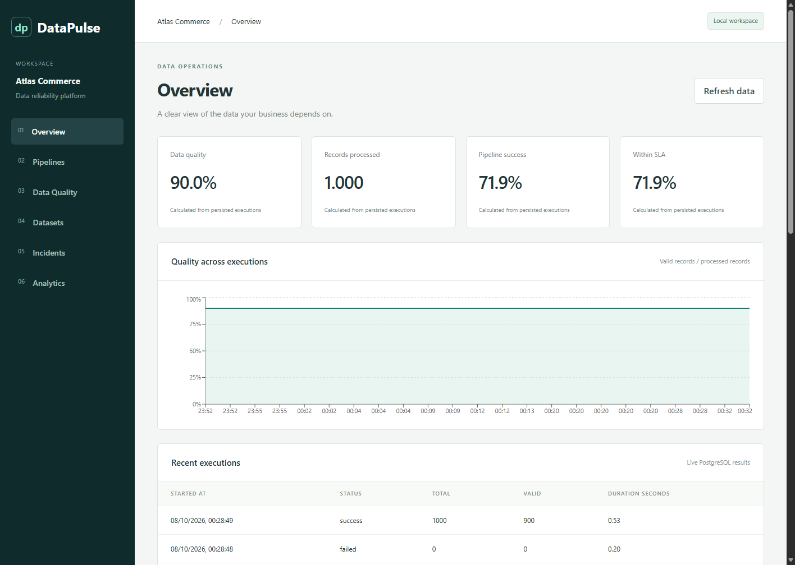

# DataPulse — Plataforma de Confiabilidade e Inteligência de Dados

Confiabilidade de dados e análise comercial para a empresa fictícia Atlas Commerce.
O sistema processa arquivos reais com dados sintéticos, preserva os registros originais,
coloca pedidos inválidos em quarentena e publica resultados analíticos validados no PostgreSQL.
O painel React consulta a API; os indicadores nunca são gerados no navegador.



## Estado da entrega

A ingestão principal, a validação de qualidade, as camadas Parquet, a disponibilização
de dados no PostgreSQL, a API administrativa, a reexecução de incidentes e o painel
estão implementados. Os módulos opcionais de PySpark, Scala e Airflow estão implementados
e possuem requisitos próprios de verificação. Consulte o
[registro das entregas e verificações executadas](docs/delivery-status.md) para conhecer
os resultados reais e as limitações restantes; a disponibilidade do código não significa
que seus testes tenham sido aprovados.

## Problema de negócio e solução

Pedidos duplicados, valores monetários inválidos, identificadores inconsistentes,
referências ausentes a clientes e produtos e registros desatualizados distorcem os
relatórios comerciais. O DataPulse mantém evidências de cada regra de validação,
isola as linhas rejeitadas e disponibiliza métricas de qualidade e operação junto
com agregações validadas de vendas por região e categoria.

## Arquitetura e tecnologias

CSV/API de demonstração → Bronze → validação/quarentena → Silver → Gold → PostgreSQL →
FastAPI → React. Consulte o [diagrama de arquitetura](docs/architecture/overview.md),
as [decisões de arquitetura](docs/decisions/001-modular-architecture.md) e a
[explicação da arquitetura em português](docs/architecture/arquitetura-pt.md).

Python 3.12, FastAPI, Pydantic, SQLAlchemy, Pandas, Parquet/PyArrow e PostgreSQL 16.6;
React, TypeScript, Vite, Tailwind, Recharts e TanStack Query. Perfis opcionais:
PySpark 3.5.4, Java 17, Scala e Apache Airflow. Docker Compose e GitHub Actions
permitem a execução local e verificações automatizadas. Não é necessária uma conta
paga em serviços de nuvem.

## Configuração e inicialização

Requisitos: Docker Desktop com WSL 2 e contêineres Linux funcionando no Windows,
ou Docker Engine com Compose no Linux/macOS. Instale o Python 3.12 para as ferramentas locais.
O Node 22.12 ou superior é necessário apenas para desenvolver o frontend fora do Docker.

Windows:

```powershell
Copy-Item .env.example .env
# Configure as credenciais do PostgreSQL e uma ADMIN_API_KEY aleatória no .env.
py -3.12 -m venv .venv
.venv\Scripts\Activate.ps1
python -m pip install -e "./backend[dev]"
docker compose up -d postgres
python scripts/migrate.py
docker compose up --build -d api frontend
```

Linux/macOS: use `cp .env.example .env`, `python3.12 -m venv .venv` e
`source .venv/bin/activate`; depois, execute os mesmos comandos de pip, migração e Compose.
Se o uv gerencia seu interpretador: `uv venv --python 3.12 .venv`.
Preserve o ambiente .venv existente em vez de recriá-lo a cada execução.

- Painel: http://localhost:5173
- API / OpenAPI: http://localhost:8000/docs
- Verificação de prontidão: http://localhost:8000/api/health (consulta real ao PostgreSQL)

O Compose monta as URLs de conexão de forma segura a partir dos campos POSTGRES_*.
O Python local usa DATABASE_URL; codifique os caracteres especiais da senha para uso
em URLs. Não publique o .env. A chave administrativa de exemplo deve ser substituída.
Informe sua chave local na página de pipelines (Pipelines) ou de incidentes (Incidents);
ela é mantida apenas na memória do navegador.

Para atualizar o código do backend durante o desenvolvimento, use a configuração adicional:
`docker compose -f docker-compose.yml -f docker-compose.dev.yml up -d api frontend`.
Essa configuração monta o código da aplicação em modo somente leitura e destina-se
ao desenvolvimento local.

## Execução de um pipeline real de dados

Na raiz do repositório, com o ambiente virtual ativado:

```bash
python -m pipelines.ingestion.generator --volume 1000 --output data/generated/demo
python -m pipelines.runner --source data/generated/demo --as-of 2026-10-07T12:00:00+00:00
```

Repita com 10000 ou 100000 registros. O conjunto de dados de teste da linha de comando
usa uma data histórica fixa como referência para garantir a reprodutibilidade.
As demonstrações HTTP usam a meia-noite UTC do dia atual; assim, solicitações idênticas
no mesmo dia geram lotes de origem idênticos.

Ingestão pela API:

```bash
python -m pipelines.ingestion.api --url http://localhost:8000 --output data/generated/api
python -m pipelines.runner --source data/generated/api
```

Execute o mesmo lote duas vezes: seu hash de conteúdo permanece igual, os dados
analíticos disponibilizados e as agregações Gold são substituídos em uma transação,
e o histórico de execução mantém as duas tentativas. Um bloqueio consultivo
(advisory lock) do PostgreSQL rejeita execuções comerciais simultâneas.

## Requisições e demonstração de incidentes

```bash
curl http://localhost:8000/api/datasets
curl http://localhost:8000/api/kpis
curl http://localhost:8000/api/analytics
curl -X POST http://localhost:8000/api/pipelines/commerce/run \
  -H "Content-Type: application/json" -H "X-API-Key: SUA_CHAVE_LOCAL" \
  -d '{"volume":1000,"seed":42}'
```

Na página Pipelines, selecione “Inject validation failure” (injetar falha de validação)
para produzir uma falha HTTP real, uma execução com falha e um incidente. Na página
Incidents, informe sua chave e solicite a reexecução do incidente. A reexecução reutiliza
a origem e a referência de validação. Incidentes resolvidos ou já reservados para
reexecução rejeitam uma segunda tentativa. Nenhuma operação com falha é apresentada
como bem-sucedida.

## Verificações

Testes de integração no Windows:

```powershell
$env:TEST_DATABASE_URL='auto'
python -m pytest -q -c backend/pyproject.toml backend/tests pipelines/tests
```

Linux/macOS: acrescente `TEST_DATABASE_URL=auto` antes do comando pytest.
Isso seleciona o banco PostgreSQL real configurado. Prefira um banco dedicado a testes;
as verificações de integração e de funcionamento básico persistem o histórico de
execuções sintéticas e incidentes intencionais. Os testes podem ignorar explicitamente
a integração quando essa variável não estiver definida.

```bash
ruff check backend pipelines scripts airflow
ruff format --check backend pipelines scripts airflow
mypy --config-file backend/pyproject.toml -p app
python -m scripts.smoke
python -m scripts.benchmark
```

Frontend: `cd frontend`, `npm ci`, `npm test`, `npm run build`. As dependências estão
registradas em package-lock.json. O perfil de testes do Docker pode executar as
verificações do backend: `docker compose --profile test run --build --rm tests`.
O GitHub Actions verifica Python, integração com PostgreSQL, compilação do frontend
com TypeScript e configuração do Docker. Ter um fluxo de integração contínua configurado
não significa que sua execução remota tenha sido aprovada.

## Qualidade, indicadores e governança

Consulte as [definições de regras e o dicionário de dados](docs/data-dictionary.md),
as [fórmulas e os denominadores dos indicadores](docs/kpi-definitions.md),
a [governança e retenção](docs/governance.md) e os [procedimentos operacionais](docs/runbook.md).
O conjunto de teste padrão de 1000 linhas contém 900 pedidos válidos e 100 linhas
rejeitadas. Cada linha rejeitada preserva os valores originais e os identificadores
de todas as regras violadas. Os resultados das regras incluem execução, conjunto
de dados, severidade, data e hora, quantidade afetada e resultado.

Os [resultados medidos de desempenho](docs/benchmarks.json) refletem esta sessão local:
1000 linhas em 11,125 s; 10000 em 16,000 s; 100000 em 110,735 s. Havia compilações
em andamento e recursos limitados; esses valores não representam a capacidade
de processamento em produção.

## Perfis avançados e limitações

Consulte as [instruções de Spark, Scala e Airflow](docs/advanced-processing.md).
Execute os perfis opcionais sequencialmente em máquinas com recursos limitados.
O DAG do Airflow agrupa o processamento em uma tarefa atômica do backend; tarefas
por etapa com retomada independente continuam pendentes. Os metadados do Airflow
em modo independente usam SQLite local; todos os dados da aplicação usam PostgreSQL.

Melhorias pendentes: recuperação completa por etapa no Airflow, retenção automática,
reconciliação de execuções interrompidas pelo encerramento do processo, um arquivo
completo de versões fixadas das dependências transitivas do Python, validação mais
abrangente dos domínios dos conjuntos de dados e ampliação dos testes de interação
no navegador. Pagamentos e estoque ainda não estão modelados; as análises atuais
abrangem pedidos, clientes e produtos. Esta configuração local de portfólio não
deve ser apresentada como pronta para produção.

## Apresentação no GitHub

Descrição: Plataforma de confiabilidade de dados para pipelines comerciais
reprodutíveis, validação auditável de qualidade e análises operacionais.
Tópicos: data-engineering, data-quality, python, fastapi, postgresql, pyspark,
airflow, scala, react, portfolio.

Use Conventional Commits reais à medida que as alterações forem revisadas. Sequência sugerida:
`chore: inicializar estrutura do repositório`, `feat: implementar ingestão de dados`,
`feat: adicionar validação de qualidade dos dados`, `feat: implementar transformações com pyspark`,
`feat: adicionar orquestração com airflow`, `feat: criar painel de monitoramento`,
`test: adicionar testes de integração dos pipelines`, `docs: documentar arquitetura e configuração`.
Não são criados commits artificiais para simular um histórico.

## Sobre o desenvolvedor

"Desenvolvido como projeto de portfólio por um estudante do 5º semestre de Engenharia de Software, com foco em Engenharia de Dados, Qualidade de Dados, Orquestração de Pipelines e Governança de Dados."

## Licença

MIT. Consulte [LICENSE](LICENSE).
