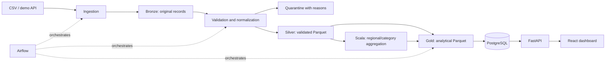

# Architecture

DataPulse is a modular application for the fictional Atlas Commerce company.
The core data flow is implemented. Optional Spark, Scala and Airflow execution has a separate verification ledger.

## Boundaries

HTTP routes live in backend/app/api, validated settings and JSON logging in core,
and lazy database connections in db. Future repositories will isolate persistence
and services will coordinate use cases. Pipelines will own transformations;
Airflow will invoke their stages rather than duplicate logic. Scala will own a
single analytical aggregation.

## Planned execution semantics

Use a stable batch identifier for idempotency and a separate execution identifier
for each attempt. Preserve original records and quarantine reasons. Publish
results transactionally. Serialize administrative runs using a PostgreSQL
advisory lock per pipeline. Never report success before execution completes.

## Resources

The minimal stack uses PostgreSQL and FastAPI only. Spark and Airflow will become
optional profiles in Phase 4. No paid cloud service is required.
